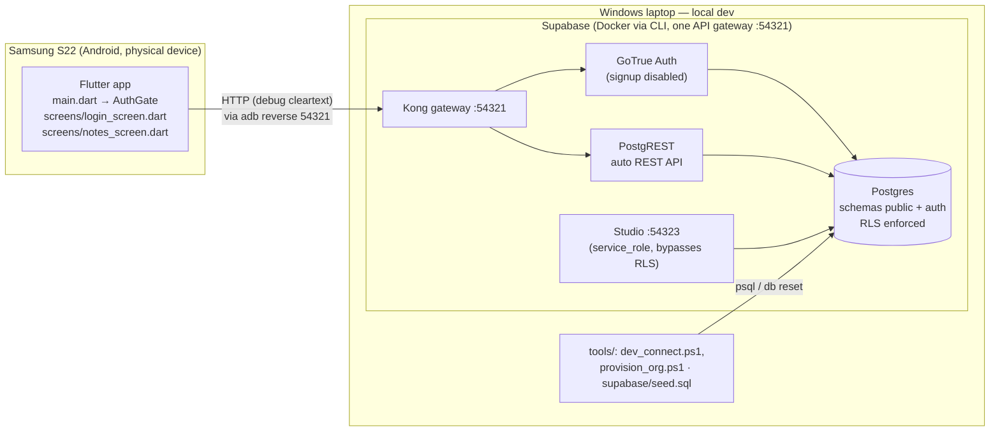

# Architecture — as built

*State as of 2026-07-21. This file describes what exists right now — not the plan (see CLAUDE.md for that). Updated whenever the structure changes; current beats complete.*

---

## 1. System overview

- **One entry point:** the app talks only to the Kong gateway on `:54321` (REST, Auth, Storage, Realtime all behind it).
- **Dev networking:** the phone reaches the laptop via `adb reverse tcp:54321 tcp:54321` and targets `http://127.0.0.1:54321`; plain HTTP is allowed in the **debug** manifest only. (Decision 001.)
- **Studio** is the RLS-bypassing admin path (`service_role`); the app never holds that key.

## 2. Flutter app (client)

| File | Role |
|---|---|
| `lib/main.dart` | Bootstrap: `Supabase.initialize(url, publishableKey)` once, then `MaterialApp(home: AuthGate)`. `AuthGate` switches Login ↔ Notes on `onAuthStateChange`. |
| `lib/screens/login_screen.dart` | Sign-in only (email+password). **No self-signup** — "Need access? Ask your admin" dialog instead (ADR 004). |
| `lib/screens/notes_screen.dart` | Org-scoped placeholder domain: resolves the user's `org_id` from `memberships` (no client-side user filter — RLS injects it), lists notes, inserts with `org_id`. Re-reads after every write (DB = source of truth). |
| `lib/theme.dart`, `lib/util.dart` | Material 3 theme (seeded ColorScheme). |

State management is plain `setState` — deliberate: smallest thing that works, no framework lock-in this early.

## 3. Data model (Postgres, schema `public`)

`auth` schema is Supabase-managed (`auth.users` = real accounts); the app never writes to it.

| Table | Columns (all `id uuid pk default gen_random_uuid()`) | Purpose |
|---|---|---|
| `organizations` | `name text`, `created_at timestamptz`, billing placeholders (`stripe_customer_id`, `subscription_status`, `seats` — all unused) | One row per customer org (tenant). |
| `memberships` | `user_id → auth.users (cascade)`, `org_id → organizations (cascade)`, `role text check in (admin, member) default member`, `created_at`, `unique(user_id, org_id)` | User↔org bridge (many-to-many + role). **The** authorization anchor. |
| `notes` | `text text`, `org_id → organizations (cascade)`, `created_at timestamptz` | Placeholder domain table; will be superseded by `observations`. |

Conventions: UUID PKs (offline-mintable, decision 002), `timestamptz` everywhere, `text` over `varchar`.

## 4. Security model (the sovereignty mechanism)

Two independent layers, both required (decision 003):

1. **Grants** (may this role do this operation at all): `authenticated` → select on all three tables, insert on `notes` only. `anon` → **nothing**. No client role can write `memberships`/`organizations` at all (`service_role` only).
2. **RLS policies** (which rows), deny-by-default:

| Table | Operation | Policy predicate |
|---|---|---|
| `memberships` | select | `user_id = auth.uid()` (own rows only) |
| `organizations` | select | `id in (my orgs via memberships)` |
| `notes` | select | `org_id in (my orgs via memberships)` |
| `notes` | insert (`WITH CHECK`) | `org_id in (my orgs via memberships)` |

No update/delete policies exist → those operations are currently impossible for every client.

**Auth flow:** publishable key identifies the client (`anon` role, no data access) → GoTrue login returns a session (JWT ~1 h + refresh token, persisted on-device, auto-attached as `Authorization: Bearer`) → requests run as `authenticated` with `auth.uid()` available to policies.

**Verified:** two-user/two-org isolation test passed on device 2026-07-21 (user A sees only Org Alpha rows, user B only Org Beta; cross-org insert rejected server-side).

## 5. Onboarding (ADR 004 — sales-led)

- Public self-signup disabled server-side (`enable_signup = false` in `supabase/config.toml`); login screen offers no signup, only an "ask your admin" dialog.
- Orgs + first admin are provisioned by the operator: `tools/provision_org.ps1` (org + confirmed user + identity + admin membership in one transaction).
- In-app admin-invite machinery: **deliberately not built yet** (needs a carefully designed `memberships` write-path — self-referencing RLS recursion risk; standard fix is a `SECURITY DEFINER` helper function).

## 6. Dev environment & reproducibility

- `supabase db reset` = replay all migrations + `supabase/seed.sql` → full test world (2 confirmed users, 2 orgs, memberships, sample notes) in seconds.
- Migrations (append-only, timestamp-ordered):
  1. `20260626184305_create_notes.sql` — notes + (historic) temporary anon grant
  2. `20260627121120_create_orgs_and_memberships.sql` — organizations, memberships
  3. `20260721141410_add_org_scoping_and_rls.sql` — org_id on notes, anon revoked, RLS enabled + policies
- `tools/dev_connect.ps1` — restores the adb reverse tunnel + checks the laptop-side listener.

## 7. Explicitly NOT built yet

Listed so nothing gets overclaimed: **PostGIS is not enabled** (the image ships with it; no `create extension` migration exists yet). No `observations` table, no map/GPS/camera/photo capture, no Storage usage, no Pl@ntNet integration or `IdentificationService` interface, no offline queue, no on-device TFLite model (D-002), no GeoServer/WMS/WFS, no GBIF export, no Stripe, no admin-invite flow. The core/domain seam (CLAUDE.md §4) exists as intent, not yet as code structure — it becomes real with `observations` + the AI adapter.
