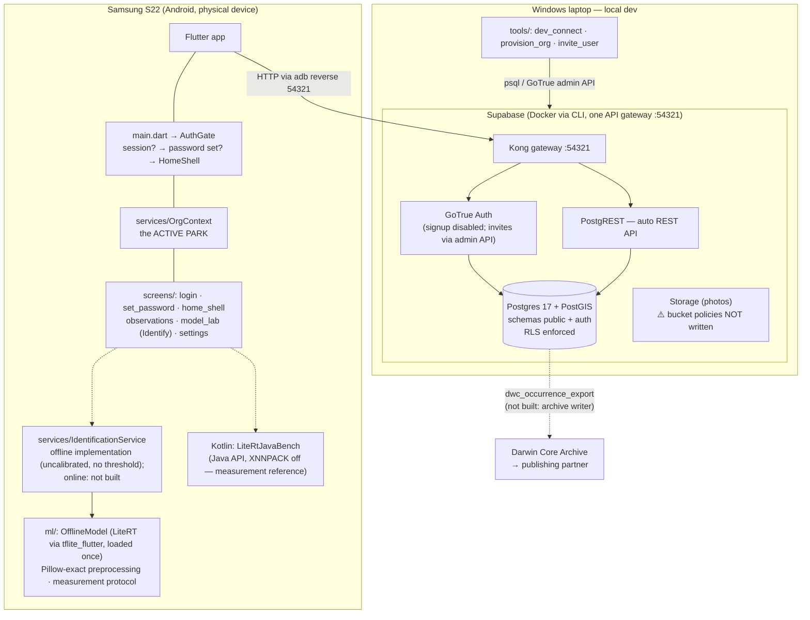

# Architecture — as built

*State as of 2026-10-10 (on-device model added for the measurement round on 2026-10-09; runtime raised to
LiteRT 1.4.2 on 2026-10-10, ADR 010; §2 and §6 updated by the app agent). This file describes what exists
right now — not the plan (see CLAUDE.md for that).
Updated whenever the structure changes; current beats complete.*

> **Provenance note.** The 2026-09-06 additions were written by the **thesis agent** at René's
> direction, not by the app agent. See the banner at the top of the 2026-09-06 entry in
> `docs/process_log.md`. The one-way rule in `CLAUDE.md` §11 (repo → vault) otherwise still stands.

---

## 1. System overview

- **One entry point:** the app talks only to the Kong gateway on `:54321`.
- **Dev networking:** `adb reverse tcp:54321 tcp:54321`; plain HTTP in the **debug** manifest only
  (decision 001).
- **Studio** is the RLS-bypassing admin path (`service_role`); the app never holds that key.

## 2. Flutter app (client)

| File | Role |
|---|---|
| `lib/main.dart` | Bootstrap + `AuthGate`. Three states: no session → Login; session but invited and no password yet → SetPassword; otherwise bootstrap `OrgContext` once and show `HomeShell`. |
| `lib/services/org_context.dart` | **The active park.** `ChangeNotifier`. On sign-in: claim invitations, load `my_parks`, resolve which is active (persisting a fallback if the server has none). `switchTo()` calls `set_active_org`. Also distinguishes "still loading" from "signed in but belonging to no park": a session outlives a `db reset`, so the app can be authenticated as a user id that no longer exists, and the records screen offers Try again / Sign out rather than a blank list. |
| `lib/services/identification_service.dart` | The **core/domain seam** as code: `IdentificationService`, `IdentificationResult`, `IdentificationCandidate`. `UnconfiguredIdentificationService` (throws) remains the stand-in for the online path. |
| `lib/services/offline_model_identification_service.dart` | **First real implementation of the seam** (source `offline_model`, provider `thesis-offline`): top-5 from the bundled model, scores an explicitly **uncalibrated** softmax (T = 1), no threshold, no decision, no checklist mask, first photograph only. Not yet wired into the record editor. |
| `lib/ml/offline_model.dart` | The bundled model (`assets/model/`, Arm 2 weight-only INT8, 1,004 classes) — loaded once per process, interpreter kept alive; verifies its SHA-256 and that outputs = rows of `labels.csv`. |
| `lib/ml/pillow_resize.dart`, `lib/ml/preprocess.dart` | The thesis reference preprocessing re-implemented **bit-exactly**: engine decode at full resolution → Pillow `BILINEAR` resize (port of `Resample.c`, Python rounding) → centre crop → /255 (ADR 009). Stage digests for diagnostics. |
| `lib/ml/labels.dart`, `inference_math.dart` | `labels.csv` (RFC 4180, row order enforced = output order); softmax, top-k, latency statistics. |
| `lib/ml/tflite_classifier.dart` | One LiteRT interpreter (tflite_flutter 0.12.1 on LiteRT **1.4.2** — the app raises the plugin's 1.4.0, whose C API loads offset-stored weights as empty tensors, ADR 010): 1 thread, optional explicit XNNPACK; `invoke()` timed alone. Domain-agnostic. |
| `lib/ml/measurement_protocol.dart` (+ `native_probe.dart`, `memory_sampler.dart`, `java_litert_bridge.dart`) | The **measurement round** (O3a–O3c): correctness vs `phone_reference.json` with stage diagnostics, memory phases, latency configurations C1/C2/C3 pinned to the X2 and an A710 core via `sched_setaffinity`, 12 MP memory reading; report to logcat in checksummed chunks. |
| `android/.../LiteRtJavaBench.kt` | LiteRT **Java API** with `setUseXNNPACK(false)` on a dedicated thread (MethodChannel `conservation_app/litert_java_bench`) — the guaranteed no-delegate reference (ADR 009). |
| `lib/screens/model_lab_screen.dart` | The **Identify** tab: model card (on-device hashes), correctness check, full measurement, offline identification of a reference photo. Reachable without login (from the login screen) because it needs no backend; with `--dart-define=MODEL_LAB_AUTORUN=true` it is the app's home and runs the protocol by itself. |
| `lib/models/models.dart` | `Park`, `ObservationSummary`, `SurveyEvent`, `Invitation`. Hand-written; each owns one `fromMap`, the only place a column name is a string. |
| `lib/screens/home_shell.dart` | Three destinations: Records · Identify · Settings (Notes left the bar 2026-10-09). |
| `lib/screens/observations_screen.dart` | The active park's records from `observations_current`, badged by which of the three determination paths produced the name. Park name always visible under the title. |
| `lib/screens/settings_screen.dart` | **The park switcher** (ADR 005) + People + admin invite management + change password + sign out. |
| `lib/screens/record_editor_screen.dart` | **Create and edit a record.** The species picker is **optional** and is explicitly the stand-in for the photograph — the intended workflow is photograph first, determination later. Coordinates typed in (no GPS plugin yet); the three determinations shown read-only on an existing record. |
| `lib/screens/members_screen.dart` | Who is in the park, with each person's record count. Admins invite, change roles and remove — removal never deletes records. |
| `lib/screens/set_password_screen.dart` | Where an invited person chooses their password; also reachable from Settings as an ordinary change. |
| `lib/screens/login_screen.dart` | Sign-in only. No self-signup (ADR 004). |
| `lib/screens/notes_screen.dart` | The original placeholder domain. Superseded in practice by `observations`; no longer in the navigation bar, kept because it is the working reference for the read/write pattern. |

State management is plain `setState` plus one `ChangeNotifier`. Deliberate: the smallest thing that
works, no framework lock-in.

**⚠️ Not yet verified.** `flutter analyze` has not been run on the 2026-09-06 additions and the app
has not been built or launched with them. See the process log.

## 3. Data model (Postgres, schema `public`)

`auth` is Supabase-managed (`auth.users` = real accounts); the app never writes to it.

### Tenancy and people

| Table | Purpose |
|---|---|
| `organizations` | one row per **park instance**. Since 2026-09-06 also carries `boundary`, `country_code`, and the dataset-level Darwin Core/EML metadata a publishing partner needs. |
| `memberships` | user ↔ org bridge, with `role`. Many-to-many, so one person can belong to several parks. **The** authorization anchor. |
| `user_settings` | `active_org_id` — which park this person is currently recording under. First per-*user* table (ADR 005). |
| `invitations` | admin-created, e-mail-addressed, claimed on first sign-in (ADR 006). |

### The domain

| Table | Purpose |
|---|---|
| `taxa` | the label space. Not org-scoped. Mixed-rank (species **and** genus rows). Carries `gbif_taxon_key` / `accepted_gbif_key`. |
| `checklist_entries` | org → taxon, with tier and `is_model_class`. What the model's output mask is built from. |
| `model_versions` | which artefact produced a prediction. |
| `survey_events` | the Humboldt Extension layer. Eight of the 55 ratified terms. **Nullable** from `observations` — most records are opportunistic. |
| `observations` | the `dwc:Occurrence`. `geometry(Geometry,4326)`, point or polygon. **No `scientific_name` column** — see below. |
| `identifications` | **append-only** determination log. `source ∈ {offline_model, online_service, human}`. |
| `observation_media` | photos; `organ` is what Pl@ntNet takes as a parameter. |
| `notes` | the original placeholder. Left in place. |

### Views

| View | Purpose |
|---|---|
| `observations_current` | an occurrence joined to whichever identification is accepted. **This is what the records list reads** — there is no denormalised name column to read instead. |
| `observations_wide` | one row per observation with the **offline / online / expert determinations side by side as columns**, plus whichever is accepted. A read view over the append-only log — none of these are stored columns, and none reaches GBIF. What the record editor reads. |
| `my_parks` | one row per park the caller belongs to, with role and active flag. What the Settings switcher reads. |
| `dwc_occurrence_export` | the Darwin Core Occurrence core, column names verbatim. **Contract: everything in it is publishable as it stands** (ADR 007). |
| `dwc_export_readiness` | per record, what a publishing partner would reject. Part of the feature, not a debugging aid. |

All views are `security_invoker`, so they inherit the RLS of their base tables rather than running as
the view owner. **A view still needs its own `GRANT`** — `observations_current` shipped without one
and every user would have hit `permission denied`; test 19 now asserts this can't recur.

### Why there is no `scientific_name` on `observations`

Darwin Core allows exactly one Identification per Occurrence. The app needs three or more — on-device
model, online service, expert — and none may overwrite another, because that comparison is the
thesis' central measurement. So `identifications` is a child table, and Darwin Core is what the
system **projects to at export**, with superseded determinations serialised into
`dwc:previousIdentifications`. Full reasoning: `docs/decisions/007`.

Conventions: UUID PKs (offline-mintable, decision 002), `timestamptz` everywhere, `text` over
`varchar`. `event_date` is client-supplied field-capture time; `created_at` is server arrival. Never
conflate them.

## 4. Security model (the sovereignty mechanism)

Two independent layers, both required (decision 003), now on ten tables and four views:

1. **Grants** — `authenticated` only; `anon` has nothing. Note the shape of the grants, because it
   encodes policy:
   - `identifications`: **select and insert only.** No update grant, ever. That is what makes the
     determination log append-only, and it is enforced by Postgres rather than by application code.
   - `observations`, `observation_media`, `survey_events`: select/insert/update. A field worker must
     be able to fix a typo.
   - `taxa`, `model_versions`: select only — loaded by migration and tooling.
2. **RLS policies**, deny-by-default, all on the same predicate:
   `org_id in (select org_id from memberships where user_id = auth.uid())`.
   Exceptions worth knowing: `user_settings` is keyed on `user_id = auth.uid()`; `invitations` is
   admin-only *for that park*; `taxa` and `model_versions` are readable by everyone.

**Three `SECURITY DEFINER` / privileged functions**, each existing to avoid a policy that would have
to query its own table:

| Function | Why it is a function |
|---|---|
| `accept_identification(uuid)` | flipping the exclusive `is_accepted` flag atomically without granting clients UPDATE on `identifications` |
| `accept_pending_invitations()` | the **only** write path to `memberships` from a client. Avoids the self-referencing RLS recursion decision 003 flagged. |
| `set_active_org(uuid)` | an RLS policy can check who owns a `user_settings` row but not whether the value being written is a park the caller belongs to |
| `park_members(uuid)` | the e-mail lives in `auth.users`, which clients cannot read |
| `remove_member(uuid, uuid)` | admin-only membership deletion, with a last-admin guard. **Records are never touched** |
| `set_member_role(uuid, uuid, text)` | promote/demote, same guard |
| `record_identification(...)` | insert a determination and accept it in one call — two writes that must not half-succeed. **SECURITY DEFINER** (it reads `auth.users` for `dwc:identifiedBy`), so its organisation check is explicit inside the function rather than left to RLS |

**The rule, stated because breaking it cost a session:** a `SECURITY INVOKER` function runs with the
caller's privileges, and `authenticated` cannot read `auth.users`. Any function needing the caller's
e-mail must be `SECURITY DEFINER` **and** must then re-state the organisation check RLS is no longer
performing for it. `supabase/tests/test_function_privileges.sql` asserts both halves.

**Verified 2026-09-08:** 39 assertions across three suites, 0 failures.

**Verified 2026-09-06:** both migrations applied to a real PostgreSQL 16 + PostGIS 3 instance;
34 assertions pass, 14 negative tests correctly rejected, across
`supabase/tests/test_observations_rls.sql` and `supabase/tests/test_org_context_and_export.sql`.
This includes the two-user/two-org isolation of 2026-07-21, now automated, extended to a
**multi-park** person, and covering the new tables.

## 5. Onboarding (ADR 004 policy, ADR 006 mechanism)

- Public self-signup disabled server-side (`enable_signup = false`).
- Orgs + first admin: `tools/provision_org.ps1` (operator, concierge).
- Colleagues: an admin inserts an `invitations` row from Settings → `tools/invite_user.ps1` calls
  GoTrue's admin invite endpoint → the person follows the link, sets a password, and
  `accept_pending_invitations()` turns the invitation into a membership on their first authenticated
  call. Post-thesis, the middle step becomes an Edge Function.

## 6. Dev environment & reproducibility

- `supabase db reset` = replay all migrations + `supabase/seed.sql` → full test world in seconds.
- Migrations (append-only, timestamp-ordered):
  1. `20260626184305_create_notes.sql`
  2. `20260627121120_create_orgs_and_memberships.sql`
  3. `20260721141410_add_org_scoping_and_rls.sql`
  4. `20260905120000_create_observations_and_identifications.sql` — PostGIS, the domain, RLS
  5. `20260906090000_org_context_invitations_and_dwc_export.sql` — park context, invitations, export
  6. `20260907100000_members_wide_view_and_storage.sql` — member management, `observations_wide`,
     placeholder photo bucket
  7. `20260908090000_fix_record_identification_privileges.sql` — `record_identification()` was the
     one SECURITY INVOKER function reading `auth.users`, so every save of a determination failed
     with "permission denied for table users" *after* the observation row had already been written
- Tests: `supabase/tests/*.sql`, run with psql against the local DB. Each rolls back; the database is
  unchanged afterwards.
- **`tools/apply_and_verify.ps1`** — one command: `db reset`, both SQL suites, PASS/FAIL count, and
  a look at the three determinations and the GBIF export. Run this after pulling schema changes.
- Seed accounts, all `password123`:
  `admin@park.at` (**admin of testPark_A**) · `ranger@park.at` (member of testPark_A) ·
  `usera@test.at` (admin Alpha) · `userb@test.at` (admin Beta) ·
  **`ranger@test.at` — member of THREE parks**, the switcher case, on screen after every reset.
- **On-device model (ADR 009):** `assets/model/` = the thesis file + `labels.csv` (hashes checked on
  device); `assets/model_check/` = the thesis' `phone_reference.json` + `ref_0N.jpg`, Pillow stage
  expectations and a synthetic 12 MP JPEG (generators in `tools/model_check/`).
  - `flutter test test/ml` — pins the Dart resize port to Pillow (hash-exact), labels and statistics.
  - **`tools/measure_model.ps1`** (or `.bat`) — the whole measurement round in one command, phone on
    USB, no backend: analyze → unit tests → release build → O3a from the APK → install → autorun
    protocol → `dumpsys meminfo` sampling → report reassembly → XNNPACK attribution → (conditional)
    TFLite Benchmark Tool. Raw output: `docs/measurements/<date>_arm2_phone/raw/<timestamp>/`.
  - `tools/model_check/desk_study.py` — the desktop study behind ADR 009 (output in
    `docs/measurements/2026-10-09_desk_study/`).
  - `tools/model_check/inspect_buffers.py` — reads a `.tflite` directly (no TensorFlow needed) and shows
    which constants are stored inline and which at an offset after the FlatBuffer; the evidence behind
    ADR 010.
  - **Runtime pin (ADR 010):** `android/app/build.gradle.kts` declares `litert` and `litert-gpu` 1.4.2,
    which Gradle also applies to tflite_flutter's own 1.4.0 declarations — one native runtime for both
    bindings. The model file is the thesis file unchanged.

## 7. What is deliberately NOT built yet

- **Capture flow** — no map, no GPS, no camera, no photo upload, no offline queue, no sync.
  Records *can* be created and edited by hand, with typed coordinates and an **optional** species.
  **The photograph is the missing centre of this**: the design is photograph → on-device model
  proposes → online service proposes → a person confirms, and only the last step exists.
- **An expert role.** `memberships.role` is `admin | member`. Whether determination should be gated
  by a third role, or instead by *which* determinations may be written `verified` rather than
  `unverified`, is an open question — see the 2026-09-08 process-log entry.
- **Identification is half there.** The offline model runs on the device behind the seam
  (`OfflineModelIdentificationService`) and in the Identify tab — **for measurement, not yet in the
  capture flow**: no calibration temperature, no per-species thresholds (both come from the thesis),
  no taxa mapping, not wired into the record editor. The Pl@ntNet (online) adapter does not exist.
- **No Darwin Core Archive writer.** `dwc_occurrence_export` produces the rows; nothing yet writes
  `occurrence.tsv` + `meta.xml` + EML and zips them.
- No GeoServer/WMS/WFS, no Stripe, no member removal or role change, no iOS build.

## 8. Known holes

- **⚠️ The Storage bucket is a PLACEHOLDER.** `observation-photos` exists with policies scoped by
  *path convention* (`<org_id>/…`) that **nothing enforces** — a client that writes to another org's
  prefix is stopped only by the policy's own subquery, and the convention itself is not validated.
  Good enough to unblock photo upload; **not** good enough to be part of the sovereignty claim. The
  real design must decide private-with-signed-URLs vs public-read and enforce the path.
- **The Dart of 2026-09-06 is unverified** — `flutter analyze` not run, app not launched.
- **GeoServer and per-org RLS.** GeoServer connects as one fixed database user, so `security_invoker`
  gives it *that* user's row visibility, not each end user's. Per-organisation OGC layers will need
  either one store per org or a parameterised SQL view. Not a bug; a design step not yet taken.
