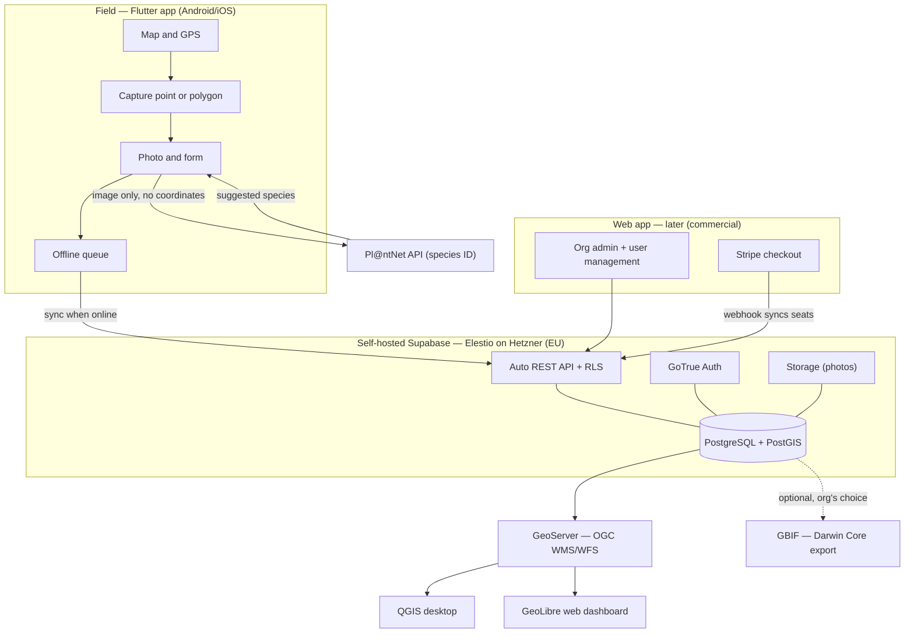

# Conservation Field-Data App — Project Brief & Build Plan

*Rough working document. Doubles as the basis for the project's `CLAUDE.md`. Last updated: June 2026.*

---

## 1. What it is

A mobile field-data app for conservation organisations. A field worker stands at a location, captures a geotagged **point or polygon**, photographs the species, an AI (**Pl@ntNet**) suggests the identification, and the result becomes a structured, geotagged, timestamped record in **the organisation's own database**.

Unlike consumer apps (iNaturalist, the Pl@ntNet app), the organisation **owns and controls its data**, sees **only its own records** (no crowd-sourced noise), can connect **its own GIS** directly to it, and **decides for itself** whether to publish anything to GBIF.

> **The differentiator (and the thesis contribution):** an organisation-first, standards-based architecture with **configurable data sovereignty** and **GIS interoperability** — not the citizen-science silo model the existing apps use.

---

## 2. Who it's for

- Conservation NGOs, **national parks**, environmental agencies, and increasingly-regulated companies that must document biodiversity on their land.
- **Sovereignty matters most at the public-sector / regulated end** (a genuine differentiator there); it's a nice-to-have for small NGOs.

---

## 3. Architecture & Stack

**Components**

- **Flutter** — cross-platform field-capture client (one codebase, Android first; iOS needs a Mac to build).
- **Supabase (self-hosted, open-source)** — PostgreSQL + **PostGIS**, GoTrue auth, Storage, Realtime, auto REST API (PostgREST).
- **Pl@ntNet API** — identification; **only the image is sent, no coordinates**, so location never leaves the org.
- **GeoServer** — exposes the PostGIS layer via **OGC WMS/WFS** for QGIS and the GeoLibre dashboard.
- **GBIF (optional)** — Darwin Core Archive export, entirely the organisation's choice.
- **Web app (later)** — org admin + user management + Stripe checkout + webhook → Supabase.
- **Hosting** — **Elestio-managed Supabase on a Hetzner EU server**: sovereign *and* fire-and-forget on the ops side.

---

## 4. Data Model — how the "schemas" actually work

**One PostgreSQL database.** Inside it are several *schemas* (namespaces / folders):

- `auth` — **Supabase-managed**; holds the real user accounts. You don't build or touch this.
- `storage`, `realtime`, … — also Supabase-managed.
- `public` — **yours**; all your own tables live here.

**Your tables (all in `public`, related by foreign keys):**

| Table | Purpose | Key fields |
|---|---|---|
| `organizations` | one row per customer org | `id`, `name`, + later `stripe_customer_id`, `subscription_status`, `seats` |
| `memberships` | links a user to an org (your "user management") | `user_id` → `auth.users`, `org_id` → `organizations`, `role` |
| `observations` | the field data (the "plant wrapping") | `id`, `org_id`, `geometry` (PostGIS), `photo_url`, `created_by`, `event_date`, `scientific_name` (Darwin Core), `attributes` (JSONB for variable, use-case-specific fields) |

**Not** separate databases or separate schemas — one database, one schema you work in (`public`), several tables tied together by foreign keys. **Row-Level Security on `org_id`** is what guarantees each org sees only its own rows.

---

## 5. Data Sovereignty — three tiers

1. **Public** — the org publishes its own observations to GBIF (Darwin Core), by deliberate choice.
2. **Private + cloud AI** — everything stays in the org's own DB; only the bare image (no coordinates) goes to Pl@ntNet.
3. **Fully sovereign** — a self-hosted identification model; nothing leaves the org (future work).

Self-hosted Supabase on **EU infrastructure (Elestio + Hetzner)** = EU jurisdiction, no US CLOUD Act exposure. Data residency *and* sovereignty.

---

## 6. Reusability — core vs domain layer

- **Core (domain-agnostic):** map, location, point/polygon capture, photo, form, offline queue, sync, auth, multi-tenancy.
- **Domain layer (swappable):** the observation fields + form, the AI adapter (**Pl@ntNet behind an `IdentificationService` interface**), the labels.
- Swap the domain layer → a new use case on the same core. **Build concrete now, behind clean interfaces — not a configurable engine.**

---

## 7. Build Path

0. **Foundations** — Flutter toolchain, GitHub repo, `CLAUDE.md`, Supabase CLI for local dev + migrations.
1. **Prove the loop** — `flutter create` + run on device; `supabase start` runs the backend locally. Don't build features until both are green.
2. **Schema + multi-tenancy** — `organizations`, `memberships`, `observations` (PostGIS + JSONB), RLS policies. Wire `supabase_flutter`, implement auth, prove one real round-trip. *(The defensible heart of the thesis.)*
3. **Capture flow** — map, GPS, point/polygon, photo, form, offline queue + sync, Pl@ntNet via the adapter. *(The app's reason to exist.)*
4. **Org / user management** — invitations, admin screen, roles, seat checks. *(Minimal for the thesis: a provable RLS isolation + two demo orgs is enough; polished self-service is commercial polish.)*
5. **Sovereign deploy + GIS interop** — Elestio Supabase on Hetzner EU, apply migrations, point the app at it; GeoServer exposing PostGIS via OGC; optional GeoLibre dashboard. *(Where you demonstrate the sovereignty thesis.)*
6. **Evaluation + writing** — SUS field test, Pl@ntNet accuracy assessment, feature/architecture comparison (iNaturalist / QField / ArcGIS Field Maps), thesis write-up. *(The academic deliverable.)*
7. **(Post-thesis) Commercial** — Stripe (web checkout + Edge Function webhook + entitlement read), polished self-service org management, onboarding, sales.

---

## 8. Realistic Timeline (with AI usage)

| Phase | Focus | Rough focused effort | Where Claude Code helps most |
|---|---|---|---|
| 0. Setup | Toolchain, repo, `CLAUDE.md`, local Supabase | a few days | scaffolding, `.gitignore`, `CLAUDE.md` draft |
| 1. Prove the loop | App runs on device; backend runs locally | 1–2 days | — (you just confirm it works) |
| 2. Schema + multi-tenancy | Tables, RLS, migrations, auth, first round-trip | ~1–2 weeks | **high** — generating tables, RLS, migrations |
| 3. Capture flow | Map, capture, photo, form, offline sync, Pl@ntNet | ~3–5 weeks | **high** — widgets, plugin wiring, sync logic |
| 4. Org / user mgmt | Invites, admin screen, roles, seat checks | ~1–2 weeks | **high** — standard CRUD + auth flows |
| 5. Sovereign deploy + GIS | Elestio + Hetzner, GeoServer OGC, (GeoLibre) | ~1 week | medium — config + setup guidance |
| 6. Evaluation + writing | SUS, accuracy, comparison, write-up | ~4–6 weeks | medium — analysis & drafting (not the field/human parts) |
| (later) Commercial | Stripe, polished admin, onboarding | post-thesis | high on code; sales is on you |

> **Calibration:** "Focused effort" ≠ elapsed time — part-time, calendar time runs longer. Given an **end-October submission target** and the **August Kelag internship** eating part of the summer, treat phases 2–4 as the core build to land by late summer, and **protect September–October for phases 5–6** (evaluation + writing), which can't be AI-accelerated the way coding can. AI compresses the *building*; it does not compress field tests, real users, GBIF-partner lead times, or writing.

---

## 9. Thesis vs Commercial

- **Thesis critical path:** a working capture app + the sovereign, GIS-interoperable architecture + the evaluation. (Phases 2–3, 5–6.)
- **Commercial, defer:** full self-service org-admin UI, Stripe billing, onboarding, going to real orgs. (Phases 4-polish, 7.)

---

## 10. Settled decisions

- **Supabase (open-source software)**, self-hosted on **EU infrastructure via Elestio + Hetzner** — *not* the hosted US service.
- **Shared multi-tenancy:** one database, `org_id` + **RLS** — **not** one instance per tenant.
- **GoTrue auth** (built into Supabase) — **not** Keycloak (no extra service to run).
- **Stripe on a web page + webhook**, entitlement read-only in the app — **deferred to post-thesis**.
- **Flutter**, **migrations-first** (Supabase CLI), code in **GitHub**.
- **Design Science Research** methodology; **Darwin Core** alignment for the data model.
